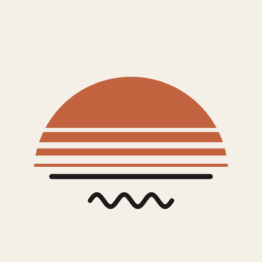

<div align="center">



# Auralys

**A YouTube Music player for Android, dressed in Liquid Glass.**

*Pemutar YouTube Music untuk Android dengan tampilan Liquid Glass.*

<br/>

[](https://auralys.my.id/)
[](https://auralys.my.id/)
[](LICENSE)
[](app/src/main/kotlin)

<br/>

<a href="https://auralys.my.id/">
  
</a>

<br/>
<br/>

[**Features**](#features) · [**Build**](#build-from-source) · [**License**](#license) · [**Credits**](#credits)

</div>

---

<h2 align="center"><a id="features"></a>Features</h2>

<table>
  <tr>
    <td width="50%" valign="top">

#### Look and feel
- Liquid Glass design with a refracting glass navigation bar
- Dynamic Island with synced lyrics
- Lyrics on the lock screen
- Ambient mode and animated covers (Spotify Canvas, Apple Music motion artwork)
- App icon styles, app fonts and themes
- Resizable home-screen widget

</td>
    <td width="50%" valign="top">

#### Sound
- Easy equalizer with presets
- Sound styles: Sped up, Slowed + reverb, Nightcore, Lo-fi, 8D, Concert
- Crossfade, gapless playback and loudness normalization
- Sleep timer and music alarm

</td>
  </tr>
  <tr>
    <td width="50%" valign="top">

#### Lyrics
- Synced lyrics with word-by-word highlighting
- Several lyrics sources, with a picker per song
- Lyrics translation

</td>
    <td width="50%" valign="top">

#### Library
- YouTube Music account and library sync
- Downloads for offline listening
- Music files stored on the phone
- Spotify account: playlists and Liked Songs
- Import playlists from Spotify and Apple Music links

</td>
  </tr>
  <tr>
    <td width="50%" valign="top">

#### Share and create
- Song poster maker with automatic photo cut-out
- Listen Together with friends

</td>
    <td width="50%" valign="top">

#### More
- Listening streak, statistics and recap
- Music recognition
- Sync with Auralys for Windows by QR code

</td>
  </tr>
</table>

---

<h2 align="center"><a id="build-from-source"></a>Build from source</h2>

Requirements: JDK 21 and the Android SDK (compileSdk 37).

```bash
./gradlew :app:assembleFossRelease
```

Release builds are signed with the key described in `~/AuralysKeys/keystore.properties` (`storeFile`, `storePassword`,
`keyAlias`, `keyPassword`). That file and the key are not part of this repository; without them the build is signed with
the debug key.

---

<h2 align="center"><a id="license"></a>License</h2>

Auralys is a fork of [Metrolist](https://github.com/MetrolistGroup/Metrolist) and, like Metrolist, is free software under the
[GNU General Public License v3.0](LICENSE). Parts taken from other open-source projects are listed in [NOTICE](NOTICE).

<h2 align="center"><a id="credits"></a>Credits</h2>

<p align="center">
  <a href="https://github.com/MetrolistGroup/Metrolist">Metrolist</a> and its contributors
</p>

---

<div align="center">

Auralys is not affiliated with, endorsed by or associated with YouTube, Google LLC, Spotify, Apple or Metrolist Group.
All trademarks belong to their respective owners.

<br/>
<br/>

**Made by DAPZ.DEV**

</div>
